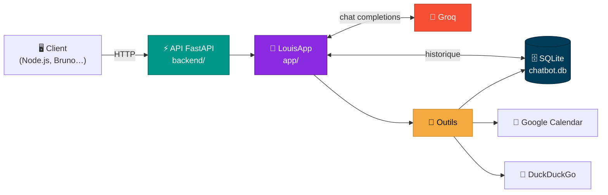
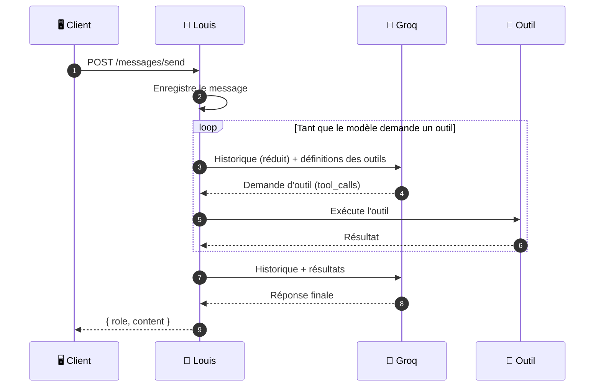

<div align="center">

# 🤖 Louis

### Un assistant IA en français, avec ses propres outils

*Louis discute, consulte ton agenda, cherche sur le web et se souvient de vos conversations.*

<br>


<br>

[✨ Fonctionnalités](#-fonctionnalités) •
[🏗️ Architecture](#️-architecture) •
[🚀 Installation](#-installation) •
[📡 API](#-api) •
[🧰 Outils](#-outils-de-lagent) •
[🗺️ Roadmap](#️-roadmap)

</div>

<br>

---

## ✨ Fonctionnalités

<table>
<tr>
<td width="50%" valign="top">

### 💬 Conversation
Louis répond en français via un modèle hébergé chez **Groq** (API compatible OpenAI).
Le modèle est configurable dans le `.env`.

</td>
<td width="50%" valign="top">

### 🧰 Appel d'outils
Le modèle décide seul quand utiliser un outil : heure, agenda, recherche web, base de données. Il enchaîne autant d'appels que nécessaire avant de répondre.

</td>
</tr>
<tr>
<td width="50%" valign="top">

### 🧠 Mémoire
Chaque message est enregistré dans **SQLite**. Seule la fin de la conversation est envoyée au modèle, pour rester sous les limites de tokens.

</td>
<td width="50%" valign="top">

### 📡 API REST
Une API **FastAPI** expose l'agent, avec une route de santé pour la supervision. Elle est prête à être appelée par un backend Node.js.

</td>
</tr>
</table>

---

## 🏗️ Architecture



### 🔁 Comment Louis répond à un message



### 📁 Structure du projet

```text
agent/
├── 🤖 app/                      # Le cœur de l'agent
│   ├── LouisApp.py              # Boucle modèle → outils → modèle
│   ├── client.py                # Client Groq (format OpenAI)
│   ├── db.py                    # SQLite : historique, réduction du contexte
│   └── tools/
│       ├── TOOLS.py             # Définitions des outils + registre
│       ├── Hour.py              # 🕐 Heure actuelle
│       ├── search.py            # 🔎 Recherche web
│       └── calendar/
│           └── google_calendar.py   # 📅 Agenda Google
│
├── ⚡ backend/                  # L'API FastAPI
│   ├── main.py                  # Point d'entrée (uvicorn)
│   ├── app.py                   # Application + routers
│   ├── MessageRequest.py        # Format du body de /messages/send
│   └── router/
│       ├── root.py              # /  et  /health
│       └── messages.py          # /messages  et  /messages/send
│
├── 🧪 Louis/                    # Collection de requêtes Bruno
└── 📦 requirements.txt
```

---

## 🚀 Installation

> [!NOTE]
> Toutes les commandes se lancent **depuis le dossier `agent/`**. Les imports du projet partent de ce dossier.

### 1️⃣ Créer l'environnement

```powershell
python -m venv .venv
.venv\Scripts\Activate.ps1        # Windows
# source .venv/bin/activate       # Linux / macOS

pip install -r requirements.txt
```

### 2️⃣ Configurer le `.env`

Crée un fichier `.env` à la racine de `agent/` :

```env
GROQ_API_KEY=ta_cle_groq
BASE_URL=https://api.groq.com/openai/v1
MODEL=nom_du_modele_groq

GOOGLE_SCOPES=https://www.googleapis.com/auth/calendar.readonly
```

| Variable | Rôle | Obligatoire |
|:--|:--|:--:|
| `GROQ_API_KEY` | Clé API Groq ([console.groq.com](https://console.groq.com)) | ✅ |
| `BASE_URL` | URL de l'API compatible OpenAI | ✅ |
| `MODEL` | Modèle utilisé par Louis | ✅ |
| `GOOGLE_SCOPES` | Droits demandés à Google Calendar | 📅 agenda |

### 3️⃣ (Optionnel) Connecter Google Calendar

1. Crée un client OAuth « Application de bureau » dans la [Google Cloud Console](https://console.cloud.google.com).
2. Télécharge-le et place-le ici : `app/tools/calendar/credentials.json`.
3. Ajoute ton adresse Gmail dans **Utilisateurs test** (l'app est en mode test).
4. Au premier appel de l'outil agenda, une page de connexion Google s'ouvre. `token.json` est ensuite créé automatiquement.

> [!WARNING]
> En mode test, Google invalide le token au bout de **7 jours**. Supprime `token.json` pour te reconnecter.

### 4️⃣ Lancer l'API

```powershell
uvicorn backend.main:app --reload
```

<div align="center">

🎉 **L'API tourne sur [http://127.0.0.1:8000](http://127.0.0.1:8000)**
📖 Documentation interactive : **[http://127.0.0.1:8000/docs](http://127.0.0.1:8000/docs)**

</div>

---

## 📡 API

| Méthode | Route | Description | Codes |
|:--:|:--|:--|:--|
|  | `/` | Message d'accueil | `200` |
|  | `/health` | État de l'agent (config + base) | `200` · `503` |
|  | `/messages` | Historique de la conversation | `200` |
|  | `/messages/send` | Envoie un message à Louis | `200` · `422` |

<details>
<summary><b>📨 <code>POST /messages/send</code> : envoyer un message</b></summary>

<br>

**Requête**

```json
{
  "message": "Qu'est-ce que j'ai de prévu cette semaine ?"
}
```

**Réponse**

```json
{
  "role": "assistant",
  "content": "Voici vos prochains rendez-vous : …"
}
```

</details>

<details>
<summary><b>💚 <code>GET /health</code> : vérifier l'état de l'agent</b></summary>

<br>

**Tout va bien → `200`**

```json
{
  "status": "ok",
  "checks": { "config": "ok", "database": "ok" }
}
```

**Un élément manque → `503`**

```json
{
  "status": "error",
  "checks": { "config": "variables manquantes : MODEL", "database": "ok" }
}
```

</details>

<details>
<summary><b>🧪 Tester avec Bruno</b></summary>

<br>

Ouvre le dossier `Louis/` dans [Bruno](https://www.usebruno.com/). Toutes les routes y sont déjà prêtes, et la variable `URL_API` pointe sur `http://localhost:8000/`.

</details>

---

## 🧰 Outils de l'agent

| Outil | Ce qu'il fait | Paramètres |
|:--|:--|:--|
| 🕐 `get_time` | Donne l'heure actuelle | — |
| 📅 `get_upcoming_events` | Liste les prochains événements de l'agenda Google | `max_results` (1 à 50) |
| 🔎 `search` | Recherche sur le web (DuckDuckGo) | `search_query` |
| 🗂️ `create_table` | Crée une table SQLite (noms et types vérifiés) | `tablename`, `columns` |
| 🗑️ `drop_table` | Supprime une table SQLite | `tablename` |

<details>
<summary><b>➕ Ajouter un nouvel outil</b></summary>

<br>

1. Écris la fonction dans `app/tools/`. Elle doit **renvoyer un texte** (le modèle le lit) et renvoyer un message d'erreur plutôt que lever une exception.
2. Décris-la dans `TOOLS_DEFINITIONS` (`app/tools/TOOLS.py`) : nom, description claire, paramètres au format JSON Schema.
3. Ajoute-la dans `AVAILABLES_TOOLS` avec **exactement** le même nom.

</details>

---

## 🗺️ Roadmap

- [x] 💬 Conversation avec un modèle Groq
- [x] 🧰 Appel d'outils en boucle
- [x] 🧠 Historique persistant (SQLite) avec réduction du contexte
- [x] 📅 Lecture de Google Calendar
- [x] 🔎 Recherche web
- [x] ⚡ API FastAPI + route `/health`
- [ ] 🚦 Codes d'erreur HTTP propres (`429`, `503`) sur `/messages/send`
- [ ] 🗂️ Plusieurs conversations (`conversation_id`)
- [ ] 🐘 Passage à PostgreSQL
- [ ] 🟩 Backend Node.js branché sur l'API
- [ ] 🐳 Déploiement Docker sur VPS
- [ ] 🌊 Réponses en streaming

---

## 🔐 Sécurité

> [!CAUTION]
> Ne versionne **jamais** ces fichiers : ils donnent accès à ton compte Groq et à ton agenda Google.
>
> `.env` · `app/tools/calendar/credentials.json` · `app/tools/calendar/token.json` · `*.db`

> [!IMPORTANT]
> Louis peut lire le web **et** modifier la base de données. Le contenu d'une page web peut tenter de détourner l'agent (*prompt injection*). Garde les outils qui modifient des données sous contrôle.

<br>

<div align="center">

---

<sub>Fait avec 💜, ☕ et beaucoup de <code>tool_calls</code></sub>

</div>
